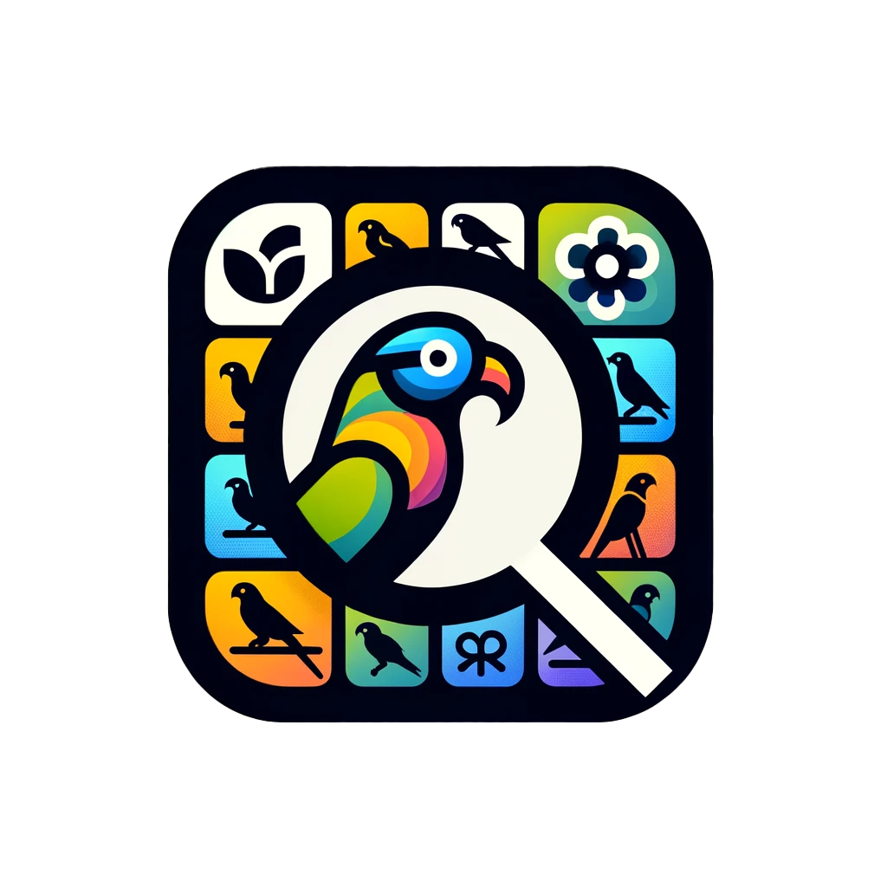

<p align="center">
  
</p>

<h1 align="center">慧眼选鸟 SuperPicky</h1>

<p align="center">
  <b>智能鸟类摄影选片 · Mac 与 Windows · 开源免费</b><br>
  拍片一时爽，选片照样爽。
</p>

<p align="center">
  <a href="https://github.com/jamesphotography/SuperPicky/releases/latest"></a>
  
  <a href="LICENSE"></a>
</p>

<p align="center">
  <a href="https://superpicky.app/"><b>官网</b></a> ·
  <a href="https://superpicky.app/videos"><b>16 集视频教程</b></a> ·
  <a href="https://superpicky.app/tutorial/"><b>图文教程</b></a> ·
  <a href="https://superpicky.app/faq.html"><b>常见问题</b></a> ·
  <a href="README.md"><b>English</b></a>
</p>

<!-- 30 秒宣传片，以 GitHub 附件形式上传 -->
https://github.com/user-attachments/assets/76c9b9e6-04ea-4a3e-9dcd-97bdcaf4bd2f

一趟拍回来三千张？选好文件夹，点开始处理。慧眼选鸟会在每张照片里找到鸟，看头部锐度、美学分和相机对焦点落在哪里，批量识别鸟种，给连拍分组、给飞版打标记，再评出一到三星。结果直接写进照片，导入 Lightroom 就能用。

在 MacBook Pro M3 Max 上每张约 0.25 秒，三千张大约 12 分钟；Windows 用 NVIDIA 显卡还有 CUDA 加速。

---

## 核心功能

| | |
|---|---|
| **智能评分** | 头部锐度 + TOPIQ 美学 → 1–3 星，最出色的再加精选旗标。[看视频 05](https://superpicky.app/videos#05) |
| **百里挑一** | 星级按本批名额分配（三星：新手 40% / 初级 30% / 大师 20%，可自定义）；开启识鸟时按鸟种分别分配，罕见鸟至少保住最好的一张。 |
| **对焦判定** | 读取 RAW 里的对焦点，判定精焦 / 合焦 / 失焦 / 脱焦。 |
| **批量识别鸟种** | BirdTrace 引擎，覆盖 10,000+ 鸟种，鸟种名写进照片标题；只在所选国家和区域的鸟种里比对，更准。[看视频 10](https://superpicky.app/videos#10) |
| **飞鸟与连拍** | SuperFlier 标记飞版，连拍自动分组，不用再一张张比几十张差不多的照片。[看视频 06](https://superpicky.app/videos#06) |
| **全球罕见度** | 基于 GBIF 全球观察数据的 0–100 罕见度，加上 IUCN 保护等级，这趟最难得的鸟一排就到前面。[看视频 11](https://superpicky.app/videos#11) |
| **选鸟结果浏览器** | 缩略图网格，按星级 / 鸟种 / 对焦 / 飞版筛选，全屏查看对焦框，两张对比，批量改评分和删除。[看视频 08](https://superpicky.app/videos#08) |
| **按鸟种归档** | 照片自动整理进“鸟种 → 星级”文件夹。 |
| **直接接上 Lightroom** | 星级、精选旗标和颜色标签写进照片或 XMP 边车：蓝色 = 飞版，绿色 = 精焦，红色 = 对焦有问题。[看视频 07](https://superpicky.app/videos#07) |
| **实验室** | 增量选片（只处理新加的照片）、多目录选片、分享报告、eBird 导出、视频分析。 |

第一次用？先看 [视频教程](https://superpicky.app/videos)：16 集，每集两分钟左右，有中文版和英文版。

---

## 下载

从 **[superpicky.app](https://superpicky.app/#download)** 或 **[GitHub Releases](https://github.com/jamesphotography/SuperPicky/releases/latest)** 下载最新正式版。国内下载慢可以用官网上的“大陆镜像”。

| 你的电脑 | 选哪个安装包 |
|---|---|
| M1–M5 苹果芯片的 Mac | macOS · Apple Silicon |
| 2020 年以前的 Intel Mac | macOS · Intel x64（用 CPU 运行） |
| 没有 NVIDIA 显卡的 Windows | Windows · x64 · CPU |
| GTX 10 系列及更早、GTX 16、RTX 20 / 30 / 40 | Windows · CUDA **CU118** |
| RTX 50 系列 | Windows · CUDA **CU130**（3 个文件下载到同一文件夹、不要改名，再运行 ①） |

拿不准？RTX 50 选 CU130，其余都选 CU118。详见 [视频 02](https://superpicky.app/videos#02)。

测试版在 [Releases](https://github.com/jamesphotography/SuperPicky/releases) 页面；日常使用建议用最新正式版。

---

## 用 AI 助手运行

在能运行终端命令的 AI 助手（如 Claude Code 或 Codex）中打开 SuperPicky 源码目录，替换下面的文件夹占位符，再粘贴这段提示词。助手必须能在本机访问源码和照片。[操作指南](SKILL.md) 介绍了命令行工作流程。

```text
请用慧眼选鸟 SuperPicky（https://github.com/jamesphotography/SuperPicky）对“<照片目录的绝对路径>”里的鸟类照片选片。先读源码目录下的 SKILL.md，使用项目的 Python 环境，并通过本机相应子命令的 --help 确认命令和参数。

先检查目录、已有结果和续跑检查点。写入前请先告诉我计划并等我确认；如果发现检查点，续跑或重跑前都要先问我。默认使用 XMP 边车，照片留在原处；不要写入内嵌元数据、移动或删除原片，也不要上传照片、元数据或报告。

如果我要求生成报告或导出 eBird 文件，请确认本地输出路径及所需的地点信息，不覆盖已有文件，也不要在线提交。经我确认执行后，请核对结果并汇报数量、失败项、实际改动和输出路径。
```

---

## 评分规则

4.5.0 起，星级由同一批照片互相比较得出，而不再比对固定分数：锐度与美学换算成批内百分位后加权排序，再按配额定星。

| 星级 | 怎么得来 |
|---|---|
| ★★★ | 本批（或本鸟种）排名前 30%；新手 40% / 大师 20% |
| ★★ | 紧随其后的 30%；眼睛看不清、或连拍组三星已满的，也降到这里 |
| ★ | 排名其余的照片 |
| 淘汰 | 无鸟，或没过基本门槛；不参与排名，也不占配额 |

详见 [视频 05](https://superpicky.app/videos#05) 和 [官网](https://superpicky.app/#rating)。

### 结果写在哪里

- **元数据**：星级、精选旗标、颜色标签写进 RAW 或 XMP 边车；标题 = 鸟种，描述 = 评分理由，城市 = 头部锐度，省份 = 美学分。
- **文件夹**：3★ → `<鸟种>/3star_excellent`，2★ → `<鸟种>/2star_good`，1★ → `Other_Birds/1star_average`，无鸟 / 淘汰 → `Other_Birds/0star_reject`。点**重置**可以全部恢复原样。
- **工作数据（`.superpicky` 文件夹）**：每个处理过的文件夹里都有一个隐藏的 `.superpicky` 文件夹，存放 `report.db`（评分、星级、鸟种、连拍分组，结果浏览器靠它重新打开文件夹而不必重新分析）和 `cache`（预览图与鸟的裁切图，占了大部分空间）。照片本身不会放在里面。删掉它不会丢失星级和鸟种名（已写进元数据），但之后要重新分析才能在结果浏览器里查看。想省空间又保留结果，用 **设置 → 高级 → 存储 → 清理所有预览缓存**，它只删 `cache`。

---

## 从源码运行

```bash
git clone https://github.com/jamesphotography/SuperPicky.git
cd SuperPicky
python3 -m venv .venv
source .venv/bin/activate        # Windows: .venv\Scripts\activate
pip install -r requirements.txt
python scripts/download_models.py
python main.py
```

本仓库的命令行用法见 [CLI 操作指南](SKILL.md)，也可查看 [官网 CLI 参考](https://superpicky.app/cli-reference)。

### 鸟种英文命名标准（AviList）

通过 **AviList v2025** 映射表支持多种英文鸟种命名标准，在 **设置 → 常用 → 鸟名显示格式** 中选择：

| 格式 | 来源 |
|------|------|
| 默认 | 鸟种库的原始名称 |
| AviList v2025 | AviList 统一英文名 |
| Clements / eBird v2024 | Cornell / eBird 分类法 |
| BirdLife v9 | BirdLife International |
| 仅学名 | 拉丁学名 |

映射表由离线脚本从 `scripts_dev/AviList-v2025-11Jun-extended.xlsx` 构建。新版 AviList 发布时（通常每年一次），替换 `scripts_dev/` 里的 xlsx 文件并重新运行：

```bash
pip install openpyxl  # 仅首次需要
python scripts_dev/build_avilist_mapping.py
```

---

## 开发团队

| 角色 | 成员 |
|---|---|
| 开发者 | [詹姆斯·于震 James Yu](https://github.com/jamesphotography)，澳籍华裔职业摄影师 |
| 模型训练 | [于若君 Jordan Yu](https://github.com/triple333sR9)：SuperEyes · SuperFlier |
| Windows 版本 | [小平](https://github.com/thp2024) · Lyapunov · [Oscar King](https://github.com/OscarKing888) |
| 模型移植与瘦身 | Jianwen Chen |

感谢所有 [赞助者](https://superpicky.app/sponsors.html)（首位个人赞助者：张钧涛），以及反馈问题、提供鸟种照片的朋友。

---

## 许可证

本软件以 **GPL-3.0 License** 开源，详见 [LICENSE](LICENSE)。这意味着你可以免费下载、使用和修改；如果分发修改后的版本，也须以 GPL-3.0 开源。

本项目使用：
- **YOLO11** by Ultralytics
- **[BirdTrace FastViT-MA36](https://huggingface.co/warden123/BirdTrace-FastViT-MA36-10K)** by Warden：鸟种识别，基于 [CC BY-NC 4.0](https://creativecommons.org/licenses/by-nc/4.0/) 许可
- **OSEA** by Sun Jiao (github.com/sun-jiao/osea)：鸟种类别表（识别模型本身已不再随包分发）
- **[SuperEyes (SuperBirdEye)](https://github.com/triple333sR9/SuperBirdEye)**、**[SuperFlier](https://github.com/triple333sR9/SuperFlier)** by [于若君 Jordan Yu](https://github.com/triple333sR9)
- **TOPIQ** by Chaofeng Chen et al.
- **[ExifTool](https://exiftool.org/)** by Phil Harvey
- **AviList**：AviList Core Team. 2025. AviList: The Global Avian Checklist, v2025. https://doi.org/10.2173/avilist.v2025，基于 [CC BY 4.0](https://creativecommons.org/licenses/by/4.0/) 许可
