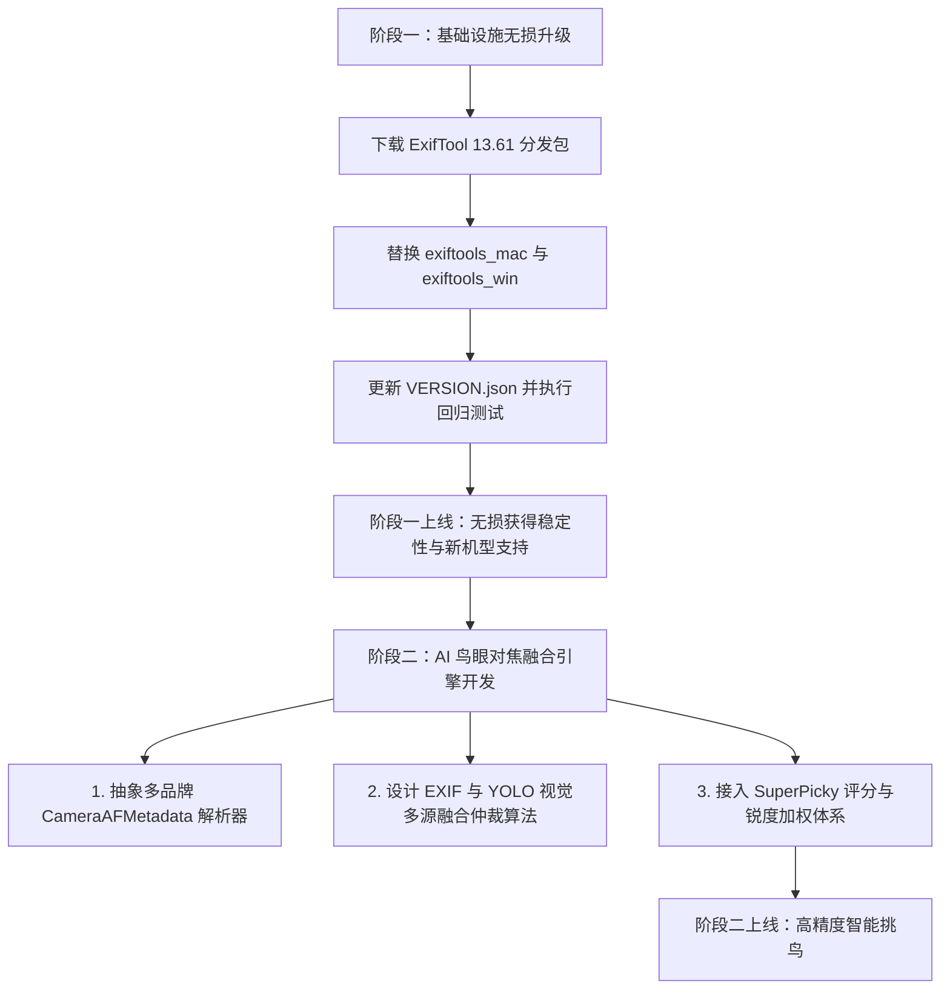

# SuperPicky: ExifTool 13.61 升级与相机 AI 鸟眼对焦融合设计文档

> **文档目标**：指导后续工程师在 SuperPicky 中完成 ExifTool 升级，并利用 ExifTool 13.60/13.61 新增的机内 AI 主体追踪元数据，升级打鸟场景下的“鸟眼合焦”判定与评分体系。

---

## 1. 背景与现状

### 1.1 SuperPicky 现状
* **当前内置 ExifTool 版本**：`13.55`（官方生产稳定版 Production Release，位于 `SuperPicky/exiftools_mac` 和 `SuperPicky/exiftools_win`）。
* **架构特性**：SuperPicky 采用读写分离的双常驻 `-stay_open` 进程，通过标准输入输出管道收发指令，并配合 `-j` (JSON) 进行快速元数据读取。
* **现有鸟眼/合焦判定**：依赖自研/内置视觉 AI 模型（如 YOLO 鸟类/鸟眼检测）识别目标，并与相机基础对焦点坐标进行重合度校验。

### 1.2 上游 ExifTool 版本现状（截至 2026 年 11 月）
* **稳定版 (Production)**：`13.55`
* **最新开发版 (Development)**：`13.61`（2026-11-05 发布，紧随 `13.60` 2026-10-28 发布）
* **同类竞品参考**：Lightroom 对焦可视化插件 `Focus-Points` 最新版 (v3.4.5) 已激进内置了开发版 `13.60`，主要为了支持 Ricoh GR IV、Pentax KF 以及 Nikon Z6 III 固件 2.0。

---

## 2. 为什么选择 13.61 而不是 13.60？

经过源码级对比，13.61 修复了 13.60 中存在的两个对 SuperPicky 来说非常严重的隐患：

1. **索尼 ARW 写入损坏修复（`github #465`，极其关键）**：
   * 13.60 及更早版本在修改 ARW 元数据时，因按 TagID 排序导致 `SubIFD` 排在 `ExifIFD` 前面，颠倒了索尼原有结构，导致**索尼官方 Imaging Edge 软件报错拒绝打开被修改的 ARW**。
   * 13.61 专门在 `WriteExif.pl` 中加入重排补丁，强制索尼文件 `ExifIFD` 优先，彻底解决兼容性问题。
2. **`-j` JSON 解析大二进制标签性能修复（`github #496`）**：
   * 修复了包含大块 MakerNotes / 预览图数据的 RAW 文件在 `-j` 批量输出时的性能劣化与卡顿，直接利好 SuperPicky 的常驻解析进程。
3. **佳能追焦历史补全（`github #507`）**：
   * 13.60 仅解码单帧快照，13.61 进一步解码了快门前 200ms 的环形追焦历史缓冲区（`AFTrackingHistory`）。

---

## 3. 各大相机品牌 AI 识鸟与鸟眼 EXIF 解码全景

在设计算法前，必须明确各相机在 EXIF 中暴露信息的天然差异：

| 品牌 | 机型代表 | 识鸟标记 | 鸟眼/部位标记 | 关键 EXIF 字段 | 说明 |
| :--- | :--- | :---: | :---: | :--- | :--- |
| **富士 (Fujifilm)** | X-H2S, X-T5 等 | ✅ 精准 | ✅ 极精准区分左右眼 | `FaceElementTypes`<br>`FaceElementPositions` | `19`=鸟身, `20`=鸟头, `21`=左眼, `22`=右眼。直接带原图坐标。 |
| **奥之心 (OM System)** | OM-1, OM-1 II 等 | ✅ 精准 | ✅ 区分鸟头/鸟眼 | `AISubjectTrackingMode`<br>`SubjectDetectStatus`<br>`SubjectDetectDetail` | `0x401`=找到鸟；状态 `257`=L1(头), `258`=L2(眼)；带详细坐标框。 |
| **佳能 (Canon)**<br>*(需 13.60+)* | EOS R1, R5 II, R6 III, R8 II 等 | ⚠️ 混标 | ✅ 区分眼/头/身 | `AFDetectedSubject`<br>`AFTrackingTarget`<br>`AFDetectedParts`<br>`AFTrackingArea` | `AFDetectedSubject` 中鸟类常与猫狗混标在 `6/7/8`；但 `AFTrackingTarget` 精准给出 `Eye` / `Head` / `Body` 及跟踪坐标。 |
| **尼康 (Nikon)** | Z9, Z8, Z6 III, Zf 等 | ⚠️ 仅菜单 | ❌ 无部位标签 | `SubjectDetection`<br>`AFCoordinatesAvailable`<br>`AFAreaX/Y/Width/Height`<br>`FocusResult` | `SubjectDetection="Birds"` 仅代表菜单设置。需在自动区域/3D追踪下依据坐标非零和 `FocusResult="Focus"` 推断锁定。 |
| **索尼 (Sony)** | A1, A9 III, A7R5 等 | ❌ 未解密 | ❌ 无部位标签 | `FocusLocation`<br>`FocusFrameSize`<br>`FocusStatus` | 索尼 AI 主体识别仍在私有加密块中。仅能依靠 `FocusLocation` 配合 `FocusFrameSize` 变小（眼部框）做物理推断。 |

---

## 4. 两阶段开发执行规划

建议将后续工程拆分为独立的两个阶段：



---

## 5. 阶段一：ExifTool 13.61 基础升级（无损替换）

### 5.1 目标
不动任何业务代码，仅将底层工具链无缝替换至 `13.61`，享受防挂死、索尼 ARW 写入安全、JSON 性能提升及新机型（如 Z6 III 2.0 等）解码支持。

### 5.2 实施步骤
1. **获取官方资源包**：
   * Unix/Perl: `https://sourceforge.net/projects/exiftool/files/Image-ExifTool-13.61.tar.gz/download`
   * Windows 64-bit: `https://sourceforge.net/projects/exiftool/files/exiftool-13.61_64.zip/download`
2. **资源替换路径**：
   * macOS: 解压 `Image-ExifTool-13.61.tar.gz`，将 `exiftool` 脚本和 `lib/` 目录同步覆盖至 `SuperPicky/exiftools_mac/`。
   * Windows: 解压 `exiftool-13.61_64.zip`，将 `exiftool.exe` 和 `exiftool_files/` 覆盖至 `SuperPicky/exiftools_win/`。
3. **版本元数据更新**：
   * 修改 `SuperPicky/exiftools/VERSION.json`，将版本号更新为 `13.61`，记录发布日期和 sha256 摘要。
4. **验证与回归测试**：
   * 运行现有的回归测试集：
     ```bash
     pytest SuperPicky/tests/test_exiftool_write_mode_none.py
     pytest SuperPicky/tests/test_exiftool_relative_path.py
     pytest SuperPicky/tests/test_exiftool_set_metadata.py
     ```
   * 验证 `SuperPicky/tools/exiftool_manager.py` 的常驻进程启动输出版本是否正确。

---

## 6. 阶段二：AI 鸟眼对焦融合引擎开发指南

### 6.1 数据结构抽象：统一相机 AF 表现层
新建或在现有元数据模块中扩展统一的数据契约（DTO）：

```python
from dataclasses import dataclass
from typing import Optional, Tuple, List
from enum import Enum

class AITargetLevel(Enum):
    NONE = "none"
    BODY = "body"
    HEAD = "head"
    EYE = "eye"
    UNKNOWN = "unknown"

@dataclass
class NormalizedAFInfo:
    camera_brand: str
    has_subject_lock: bool           # 相机机内是否判定锁定主体
    detected_species_hint: Optional[str] # 如 "bird", "animal", "unknown"
    target_level: AITargetLevel      # 锁定部位级别
    eye_used: Optional[str]          # "left", "right", "unresolved", None
    box_normalized: Optional[Tuple[float, float, float, float]] # (x, y, w, h) 归一化到 0~1
    raw_focus_confirmed: bool        # FocusResult 或 FocusStatus 是否合焦
```

### 6.2 各品牌解析器实现规范

1. **佳能（Canon，机型 R1/R5m2/R6m3 等）**：
   * 读取标签：`AFDetectedSubject`, `AFTrackingTarget`, `AFDetectedParts`, `AFTrackingArea`, `AFEyeUsed`。
   * 规则：
     * 若 `AFDetectedSubject` in `['Animal (cat)', 'Animal (dog or bird)', 'Animal (horse)']`，标记 `has_subject_lock = True`, `hint = "animal/bird"`。
     * 若 `AFTrackingTarget` == `'Eye'`，`target_level = AITargetLevel.EYE`。
     * 将 `AFTrackingArea` 像素值换算为归一化比例坐标。
2. **富士（Fujifilm）**：
   * 读取标签：`FaceElementTypes`, `FaceElementPositions`。
   * 规则：
     * 若包含 `21 (Bird Left Eye)` 或 `22 (Bird Right Eye)`，直接确定 `target_level = AITargetLevel.EYE`，坐标精准提取。
     * 若包含 `20 (Bird Head)` ➔ `HEAD`；`19 (Bird Body)` ➔ `BODY`。
3. **奥之心（Olympus / OM System）**：
   * 读取标签：`AISubjectTrackingMode`, `SubjectDetectStatus`, `SubjectDetectDetail`, `SubjectDetectArea`。
   * 规则：
     * `AISubjectTrackingMode == 'Birds; Object Found'` 且状态包含 `L2 Detail` ➔ `target_level = AITargetLevel.EYE`。
4. **索尼 / 尼康降级适配**：
   * 尼康：若 `AFAreaXPosition != 0` 且 `FocusResult == "Focus"` 且菜单开了 `Birds` ➔ 标记 `has_subject_lock = True`，`target_level = AITargetLevel.UNKNOWN`。
   * 索尼：通过 `FocusLocation` 提取对焦点，若 `FocusFrameSize` 明显小于常规单点框，推测为细分跟踪框。

### 6.3 视觉 AI 与相机元数据的“双源仲裁矩阵”

SuperPicky 已有 YOLO 鸟类/鸟眼检测算法，切忌盲目相信任何单一方面。推荐采用以下仲裁矩阵进行评分赋权：

| 场景 | 相机机内 EXIF | SuperPicky 视觉 AI (YOLO) | 像素锐度检验 | 决策结论 | 评分影响 |
| :---: | :---: | :---: | :---: | :--- | :--- |
| **黄金命中** | `EYE` (鸟眼) | 检出鸟眼，且 IoU 重合度 > 0.5 | 鸟眼区域高锐度 | **极品对焦** | 给予最高锐度权重加分，打上“鸟眼精准合焦”标签。 |
| **相机假合焦** | `EYE` (鸟眼) | 判定对焦框落在树枝/背景 | 鸟眼区域低锐度 | **误报/脱焦** | 报警扣分，判定相机拉风箱或追焦脱靶，不盲信相机。 |
| **头部补偿** | `HEAD` (鸟头) | 检出鸟眼，与头框有交集 | 鸟头/眼区域锐度高 | **优质对焦** | 次高权重，视景深深度决定是否给予星级提升。 |
| **无机内支持**<br>*(索尼/旧机)*| 无眼部标签 | 检出鸟眼，与主对焦点重叠 | 鸟眼区域高锐度 | **视觉仲裁** | 自动平滑退回到现有的纯视觉重合判定逻辑。 |

---

## 7. 交付产物与验收标准

1. **阶段一产物**：
   * `exiftools_mac/` 和 `exiftools_win/` 升级到 13.61。
   * 运行测试用例全部通过，无崩溃或挂死现象。
   * 索尼 ARW 写元数据后可在官方 Imaging Edge 中正常加载。
2. **阶段二产物**：
   * 新增/完善多品牌机内 AF 元数据解析器。
   * 单元测试：针对佳能、富士、奥之心样本照片能准确输出 `NormalizedAFInfo`。
   * 评分联动：照片评分详情弹窗或元数据面板中能清晰展示机内对焦目标状态（如 `[机内识别] 鸟眼锁定 (Eye-AF Confirmed)`）。

---

## 8. 附录：核心第三方依赖组件最新动态与演进建议（2026 年下半年）

为方便后续对 SuperPicky 整体技术栈的演进与调优评估，特对工程主要依赖进行最新版本现状与重大突破分析：

| 依赖库 | 当前 SuperPicky 使用版本 | PyPI 最新版本 (2026-11) | 重大突破 / 核心变动 | 对 SuperPicky 的建议 |
| :--- | :--- | :--- | :--- | :--- |
| **`ultralytics`** | `8.4.147` *(锁版本)* | `8.4.207` | **1. CPU 推理大幅提速 (8.4.193)**：ONNX Runtime 与 OpenVINO 在 CPU 端预测提速高达 2x；<br>**2. YOLO-World 体积骤降 (8.4.176)**：瘦身 328MB → 26MB；<br>**3. 推进 YOLO26 架构体系**。 | **谨慎评估升级**：之前版本曾因全局 monkey patch `Image.open` 导致 NEF 打开弹窗 Bug，若想吸收 2x CPU 推理红利，必须在独立分支中先做完整回归测试。 |
| **`rawpy` / `LibRaw`** | `>=0.18.0` | `0.28.0` | **1. 升级底层 LibRaw 0.22.2/0.22.3**：修复佳能 CR3 零宽度异常、富士 X-Trans 绿色插值内存越界、松下编码切片防崩溃；<br>**2. 原生暴露结构体**：Python 层开放 `libraw_lensinfo_t` 镜头数据；<br>**3. Windows ARM64 原生轮子**。 | **推荐升级**：纯粹的解码底层稳定性提升与防崩补丁，API 向下兼容良好。 |
| **`pillow-heif`** | `>=0.10.0` | `1.8.1` | **完美适配 10-bit HEIF (HIF)**：修复了索尼与佳能新机型拍摄的 HLG/Rec.2020 色彩空间解析偏灰/失真的兼容性 Bug。 | **推荐升级**：有利于提升微单直出 HIF 照片在预览窗与缩略图渲染时的色彩准确度。 |
| **`PySide6`** | `>=6.6.0` | `6.12.0` | **1. 高分屏 (HiDPI) 渲染修复**：消除 macOS Retina 与 Windows 缩放下的 1px 绘制抖动与虚化；<br>**2. 纹理异步载入性能优化**：多图翻页更平滑。 | **打包环境建议跟进**：对 SuperPicky 画面对焦框精细贴合与 100% 裁切画质呈现有正向收益。 |
| **`torch` / `torchvision`** | `2.8.0` (macOS MPS) | `2.15.0` | **1. Apple Silicon Metal (MPS) 算子库补全**；<br>**2. MPS 显存分配器优化**：降低大批量挑图爆统一内存风险。 | **保持观望**：目前 2.8.0 运行稳定，升级需重新评估打包后体积，暂无紧迫性。 |

